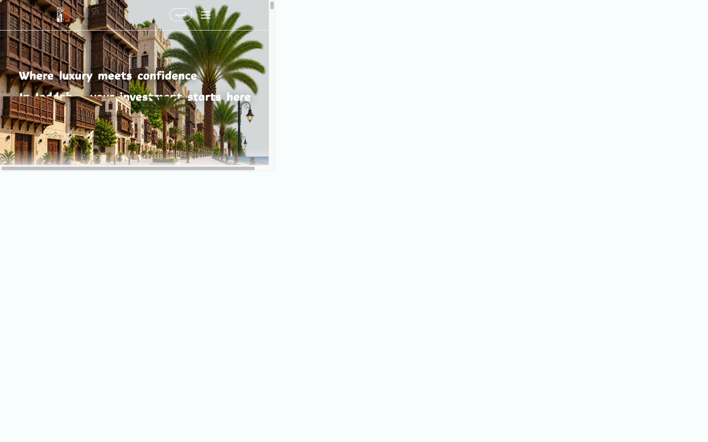
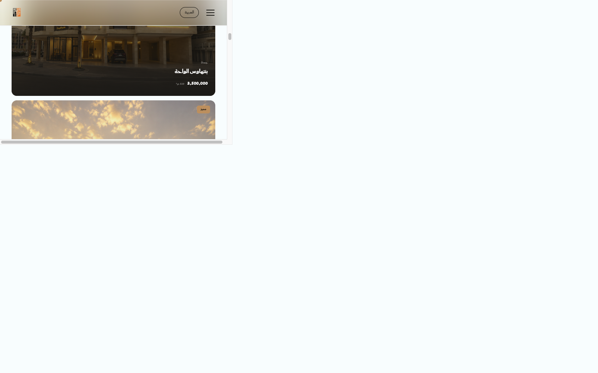
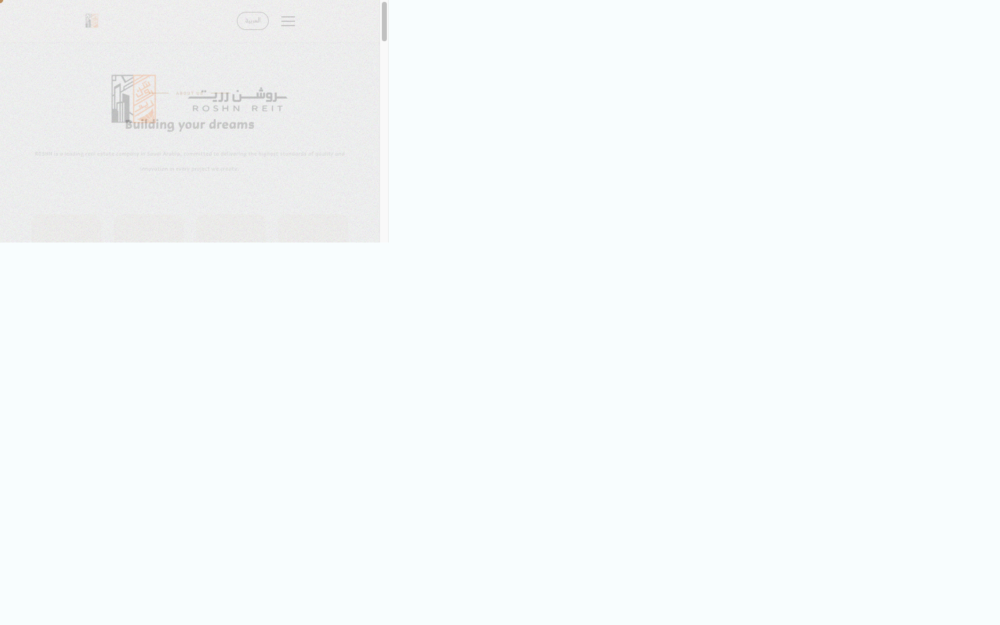
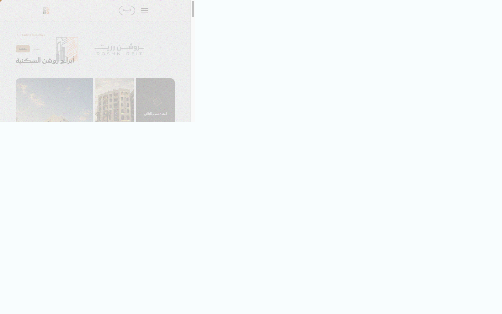
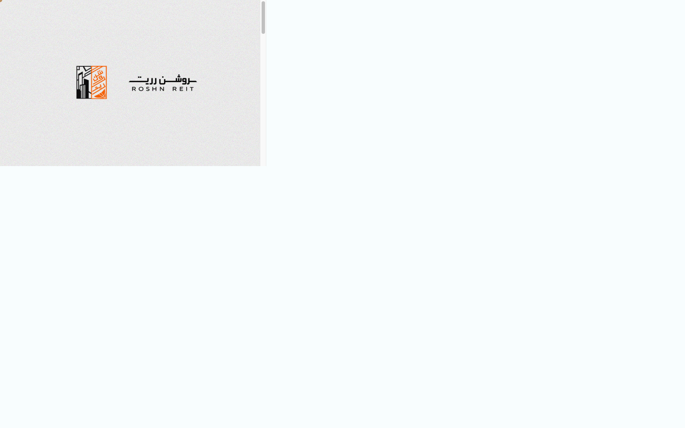

# ROSHN Real Estate

An animated bilingual real-estate experience for ROSHN residential projects in Saudi Arabia. The site supports Arabic RTL and English LTR layouts, deep project routes, project galleries, an interactive 3D viewer, animated scroll sections, and a lead contact form.

The application is built with the following stack and project capabilities:

- [@vitejs/plugin-react](https://github.com/vitejs/vite-plugin-react/blob/main/packages/plugin-react) uses [Oxc](https://oxc.rs)
- [@vitejs/plugin-react-swc](https://github.com/vitejs/vite-plugin-react/blob/main/packages/plugin-react-swc) uses [SWC](https://swc.rs/)
## Highlights

- Arabic and English language switch with persisted preference
- RTL/LTR document direction switching
- Animated splash screen and page transitions
- Responsive hero with video desktop background and mobile artwork
- Project catalogue with filters and deep detail pages
- Project gallery lightbox and Three.js model viewer
- ScrollTrigger entrance and parallax animations
- Contact form validation and success animation

## Routes

| Route | Purpose |
| --- | --- |
| `/` | Animated landing page |
| `/projects` | Filterable project catalogue |
| `/projects/:id` | Project details, gallery, map, model viewer, and inquiry form |
| `/about` | Company story, mission, stats, and team |
| `/why-us` | ROSHN advantages and testimonials |
| `/contact` | Contact form and company contact details |

## Screenshots

These screenshots were captured with Playwright at a wide desktop viewport after the splash and section animations settled.

### Animated hero



### Project section



### About Us



### Project details



### Contact



## Getting started

```bash
npm install
npm run dev
```

Open `http://127.0.0.1:5173/` in a browser.

## Validation

```bash
npm run lint
npm run build
```

## Stack

React 19, Vite, React Router, GSAP, Framer Motion, Three.js, React Three Fiber, Tailwind CSS, and Oxlint.
